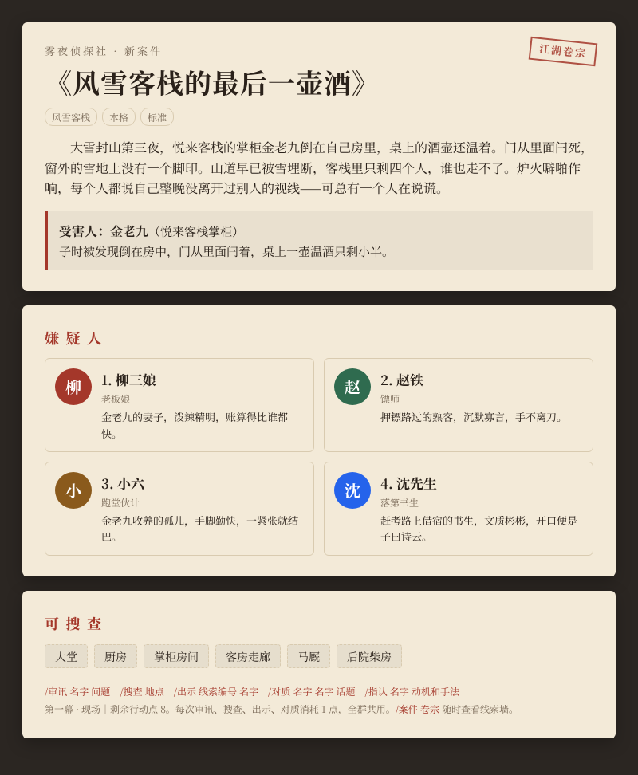
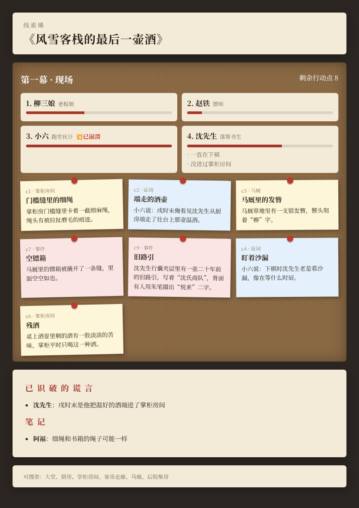
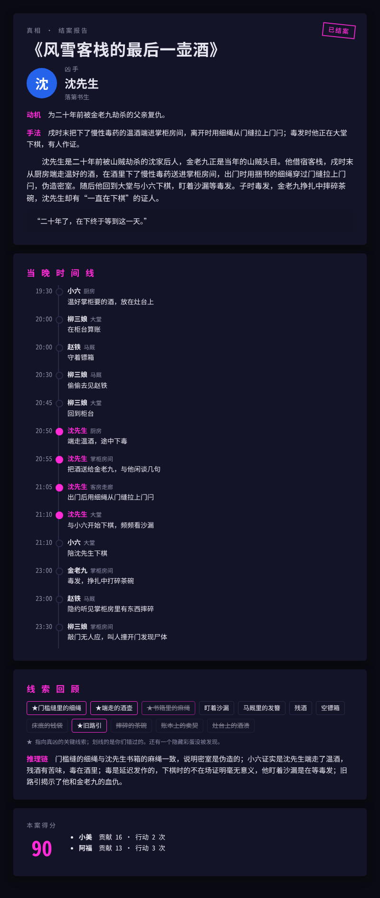

# 🕯 雾夜侦探社

AstrBot 群聊推理游戏插件。每个案件都由 AI 现场生成，群友一起审讯嫌疑人、搜查现场、出示证据，在行动点用完前指认真凶。

> 大雪封山第三夜，悦来客栈的掌柜倒在自己房里，桌上的酒壶还温着。门从里面闩死，窗外的雪地上没有一个脚印。客栈里只剩四个人，谁也走不了……

<p align="center">
  
  
  
</p>
<p align="center"><sub>开场卷宗 · 线索墙 · 结案报告（示例案件）</sub></p>

## 安装

- 在 AstrBot WebUI 的插件市场搜索「雾夜侦探社」安装；或者
- 在插件管理里通过仓库地址安装：`https://github.com/fxianglong/astrbot_plugin_mist_detective`

装好后在群里发 `/案件 开局` 即可开始。模型直接使用 AstrBot 当前的对话模型，推荐 DeepSeek、Qwen 等推理较强的模型。

## 特点

- **每局都不一样**：程序从题材库和诡计库里随机组合骨架，大模型把它写成有气氛、有人味的故事。
- **一定推得出来**：开局时先生成一份玩家看不到的真相档案，自动检查线索是否够用、时间线是否自洽、开场有没有剧透，再让模型只看线索盲推一次凶手，推不出唯一答案就重写。
- **NPC 不乱说**：每个嫌疑人只知道自己该知道的事，说过的话会被记下来，不会前后矛盾；线索何时发放、谎言是否被识破都由程序判定。
- **人人都可疑**：无辜者也有不想说的秘密，会支支吾吾制造误导；被问到痛处紧张度上升，到顶会情绪崩溃、吐露秘密。
- **三幕结构**：现场 → 疑点（突发事件推翻第一印象）→ 交锋（高潮事件、全员紧张度上升），全群共用行动点。
- **图片卷宗**：开场卷宗、软木板线索墙、结案时间线长图，每个题材一套配色；可接通义 Qwen 生图配开场插画。
- **两种新玩法**：角色扮演模式（群友各自扮演嫌疑人，其中一人是凶手，AI 写剧本当主持）；系列主线《灰蛾》（五桩案件连成一条暗线，逐章揭开幕后人）。
- **长期玩下去**：隐藏彩蛋线索、私聊提交个人推理、精品案件库与跨群重玩、趣味称号、每周定时「悬案之夜」、自定义题材。

## 玩法

| 指令 | 说明 |
| --- | --- |
| `/案件 开局 [题材] [风格] [难度]` | 开一局，例：`/案件 开局 民国 社会派 困难`，都可省略 |
| `/审讯 名字 问题` | 例：`/审讯 沈先生 你昨晚戌时在哪`，名字也可以写序号 |
| `/搜查 地点` | 例：`/搜查 厨房` |
| `/出示 线索编号 名字` | 把证据摆在嫌疑人面前，戳穿谎言 |
| `/对质 名字 名字 话题` | 让两人当面对口供；手里已有能戳穿其中一人谎言的证据时，会当场戳穿 |
| `/指认 名字 动机和手法` | 说中凶手 50 分，动机 20 分，手法 30 分；错两次即结案。群里两人以上参与时发起投票，`/赞成` `/反对`，过半通过 |
| `/案件 卷宗` | 线索墙：已知线索、口供、紧张度和笔记（`/案件 卷宗 文字` 看文字版） |
| `/提示` | 指出下一步方向，每次扣 5 分 |
| `/笔记 内容` | 记下推理，全群可见 |
| `/推理 内容`（私聊） | 提交只有自己知道的推理，结案时公布：凶手 10、动机 5、手法 5 |
| `/案件 开局 自定义 描述` | 自定义题材，例：`/案件 开局 自定义 1920 年代横渡大西洋的远洋邮轮`，会先审核 |
| `/案件 推进` | 局长（开局的人）或管理员直接进入下一幕 |
| `/案件 评分 1-5`、`/案件 案件库`、`/案件 重玩 编号` | 给刚结的案打分；高分案件进入案件库，任何群都能重玩 |
| `/案件 订阅 周五 21:00`、`/案件 退订` | 悬案之夜：每周定时自动开一局 |
| `/案件 角色扮演 [题材] [风格]` → `/加入` → `/案件 发车` | 角色扮演局：3~6 人，角色卡私聊发送（请先加机器人好友，没收到就私聊 `/我的角色`） |
| `/搜查`、`/公开 编号`、`/投票 角色名`（角色扮演局） | 每轮每人搜查一次；公开自己角色卡上的线索；第三轮后投票，真凶得票最多则侦探胜 |
| `/案件 主线`、`/案件 主线 开始`、`/案件 主线 下一章` | 系列主线《灰蛾》，破案才能解锁下一章 |
| `/案件 诊断` | 最近的案件生成统计：成功率、用时、未通过原因 |
| `/案件 题材`、`/案件 排行`、`/案件 结束 确认` | 题材列表、侦探排行与称号、放弃本案 |

审讯、搜查、出示、对质每次消耗 1 个行动点。

## 内容

- 题材（10）：风雪客栈、民国上海 · 百乐门、网红民宿 · 直播间、第七舱 · 太空站、上元夜 · 长安、雾都庄园、绿皮火车 · 1988、古镇戏班、大学社团、空中都市 · 赛博朋克，另可自定义
- 诡计（12）：拨动钟表、伪造不在场、机关密室、延迟发作、第一发现人、身份替换、死前留言误读、共谋互证、自导自演失败、利用停电天气、伪造记录、凶器消失
- 每案 1 个隐藏彩蛋线索，问到特定话题才会出现，个人 +10、本案 +5
- 称号：见习侦探 → 侦探 → 名侦探 → 神探；趣味称号「问哭人」「冤案制造机」「一眼看穿」
- 风格：本格（默认）、社会派、轻松喜剧（没有人真的死去）
- 难度：简单 3 人 / 标准 4 人 / 困难 5 人

## 配置

| 配置项 | 说明 |
| --- | --- |
| 生成案件使用的模型 | 留空即继承 AstrBot 当前会话的对话模型；也可单独选推理较强的模型（DeepSeek、Qwen-Max 等） |
| 审讯使用的模型 | 留空即继承当前对话模型；每次审讯调用一次，也可以单独选便宜快速的模型 |
| 默认风格 | 本格 / 社会派 / 轻松喜剧 |
| 唯一解检查 | 默认开启，多一次调用，明显减少推不出来的案子 |
| 群聊投票指认 / 投票时长 | 默认开启、60 秒；超时时赞成多于反对且至少一人附议才通过 |
| 发图片 | 默认开启，用 AstrBot 文转图渲染，失败自动改文字 |
| 阿里云百炼 API Key / 插画模型 / 尺寸 | 留空时自动继承 AstrBot 里已配置的阿里云百炼（通义千问）提供商的 Key；默认 `qwen-image`、`1328*1328`。两边都没有就不生成插画 |
| 自定义题材、关闭的题材/诡计、每日开局上限、案件库星级门槛 | 群管理按需调整 |
| 行动点倍率、紧张度倍率 | 实测调节奏用，默认 100% |
| 角色扮演最少人数 | 默认 4 人（3~6） |
| 保存未通过的档案原文 | 默认开启，存在插件数据目录 `debug/`，排查生成问题用 |

开一局约 3~6 次模型调用（生成、检查、可能的重写），对局中每次审讯或出示 1 次，一局大约 20~40 次。

## 版本

- v0.1：完整一局：生成、校验、审讯、搜查、出示、指认
- v0.2：对质、第三幕高潮事件、群投票指认
- v0.3：图片卷宗与线索墙、结案时间线长图、Qwen 开场插画；题材 10 个、诡计 12 种、隐藏彩蛋
- v0.4：私聊个人推理、评分与精品案件库重玩、趣味称号、悬案之夜、自定义题材、局长推进、群管理开关
- v0.5：角色扮演模式、系列主线《灰蛾》、生成诊断与稳定性加固、测试与 CI

## 开发

```bash
pip install pytest jinja2 aiohttp
python -m pytest -q tests   # 用桩模块和模拟模型跑完整对局，不需要 AstrBot 和真实模型
```

案件均为虚构，生成时会避开血腥细节、可操作的作案细节、未成年人受害与真实人物。
